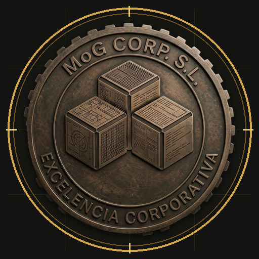

  

# 🔸 `mog-corporation/.github` · Gobernanza Org-Wide, Glifos, 🪐 Galaxia MoG y Activos R1 (`6/6`) · MoG CORPORATION

Repositorio público org-wide de [**MoG CORPORATION**](https://github.com/mog-corporation) (`🌍 Eco-Logics` · `⚙️ Ingeteyco` · `🏙️ Inversiones MoG`):
- **Perfil Público de la Organización y 🪐 Galaxia MoG:** [`profile/README.md`](./profile/README.md)
- **Glifos Oficiales Vigentes:** `🔶` Presidencia (`MoG CEo & ARQ`) · `🪐` Galaxia MoG · `🔸` MoG CORPORATION / Agentes · `🌍` Eco-Logics · `⚙️` Ingeteyco · `🏙️` Inversiones MoG *(prohibido `U+25C6`)*
- **Activos Visuales Oficiales R1 (`6/6` identidades · «El Norte»):** [`profile/assets/`](./profile/assets) y [`assets/brand/`](./assets/brand)
- **Gobernanza de Agentes:** [`AGENTS.md`](./AGENTS.md) (`writer != verifier != merger`)
- **Plantillas de Issues y Bancos CI Mínimos (`0,00 €`):** [`.github/`](./.github)

---
<strong>🔸 MoGbot Antigravity · Ejecutor de front y preview IA · MoG CORPORATION</strong>
