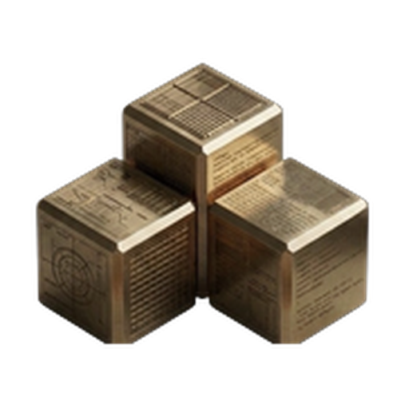

  

<h1 align="center">MoG Corporation</h1>

  <strong>Ingeniería, automatización gobernada y excelencia operativa multiempresa</strong> 
  01 · Eco-Logics Control Clima &nbsp;|&nbsp; 02 · Ingeteyco &nbsp;|&nbsp; Inversiones MoG

---

## Principios de ingeniería y gobernanza

- **Segregación estricta (`writer != verifier != merger`):** ningún autor ni último emisor certifica o fusiona sus propios cambios; toda promoción exige verificación independiente sobre el `HEAD` exacto de 40 caracteres.
- **Puertas fail-closed (`exit 0 / 1 / 2`):** lo `NO_MEDIDO` nunca equivale a aprobación; cada puerta de calidad ejecuta comprobaciones reproducibles con control positivo y negativo.
- **Identidad y marca (`MoG` / `MoG CEo`):** preservación del emblema oficial grabado en bronce (`emblem-r1`) y de la grafía corporativa canónica.
- **Operación trazable:** gobierno declarativo de flujos, plantillas de incidencias, escaneo de secretos fijado por `SHA-256` y trazabilidad completa de revisiones.

---

MoG Corporation · Verificación independiente, seguridad y trazabilidad

